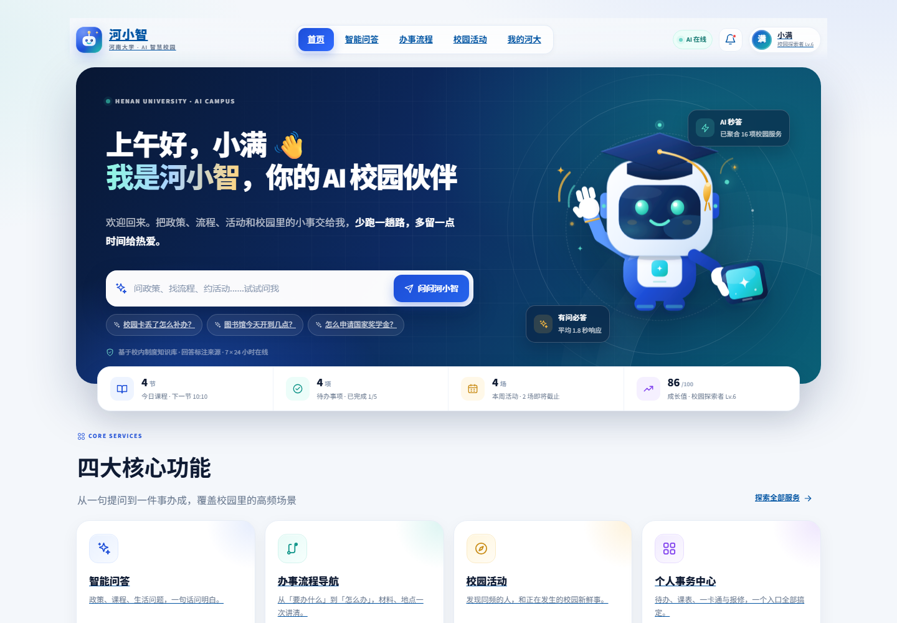

# 河小智 · 河南大学 AI 智慧校园服务平台

> 大学生黑客松「校园新物种」赛道参赛作品  
> 一个更懂河大的 AI 校园伙伴：把政策、流程、活动和校园里的小事，收进一个入口。



## 本期交付

本期聚焦 **首页**，已完成一个可直接演示的高保真校园产品首页：

- **账号注册与登录**：首次使用必须先注册；用户名由用户自选，账号号按注册顺序自动编号（如 `HXZ0001`），密码加盐哈希后存储。
- **密保问答与找回密码**：注册时必须设置「密保问题 + 密保答案」；忘记密码时通过密保问题验证身份并重置新密码，密保答案同样只保存哈希。
- **河小智 Logo 与品牌系统**：定制 SVG 徽标、AI 机器人吉祥物、蓝青渐变视觉语言。
- **动态欢迎语**：根据当前时间问候（早上好 / 上午好 / 下午好 / 晚上好），并结合当前登录用户的用户名。
- **AI 智能问答输入框**：首页直接提问，提交后跳转智能问答页并自动生成回答。
- **四大核心功能入口**：智能问答、办事流程导航、校园活动、个人事务中心。
- **个人成长档案入口**：独立成长横幅，展示成长值、徽章与志愿时长。
- **响应式布局**：1440px 桌面端、768px 平板端均完成真实浏览器验收，无横向溢出。
- **站内导航**：全站链接同标签页跳转，不新开标签页。
- **AI 办事流程导航（办事流程页）**：输入办事需求 → AI 识别需求 → 自动生成办理步骤、所需材料、注意事项 → 自动生成待办清单，支持逐项勾选完成并实时显示进度。
- **真实流程数据**：办事流程均整理自河南大学官网、教务处、校医院、图书馆等部门公开办事指南（校园卡补办、电子成绩单、缓考、请销假、转专业、图书借阅、医保报销、国家奖学金），每条流程标注依据来源。
- **调试账号**：`小明` / `c12345678`（也可自行注册）。

> 说明：五个功能入口均已预留并接通基础页面骨架，后续功能可由你继续补充或替换；
> 用户昵称、成绩、余额、活动等个性化内容为演示数据，办事流程整理自公开渠道，非河南大学官方系统。

## 免 API 的模拟测试版

项目内额外提供了 **`测试/`** 文件夹，内含一个纯静态、无需安装依赖的模拟版：

- 直接双击 **`测试/index.html`** 即可打开，不需要启动 Streamlit，也不需要配置任何 API Key；
- 数据保存在浏览器 localStorage，不上传服务器，不发起网络请求；
- 演示账号：`HXZ0001` / `demo1234`，密保答案 `1024`；
- 覆盖登录注册、智能问答、办事流程、校园活动、个人中心和成长档案等主要功能。

详细说明见 [`测试/README.md`](测试/README.md)。

## 快速启动（Windows）

### 方式一：双击启动

双击项目根目录的 **`start.bat`**。

### 方式二：PowerShell

```powershell
.\start.ps1
```

启动后浏览器访问：

**http://localhost:8501**

### 方式三：手动启动

项目已内置 `.deps` 依赖目录（Streamlit 1.50），可直接离线运行：

```powershell
$env:PYTHONPATH="$PWD\.deps"
python -m streamlit run app.py --server.port 8501
```

如需从零安装依赖：

```powershell
python -m pip install -r requirements.txt
python -m streamlit run app.py --server.port 8501
```

## 接入大模型 API（可选，已配置好）

项目默认是**纯本地知识库检索**，不联网也能演示。现在已接入大模型：问答页先用本地知识库检索，再把命中条目、制度摘录和最近几轮对话一起交给大模型，生成更自然完整的回答；「依据来源」「检索轨迹」「相关链接」照常保留。

### 配置文件

密钥放在项目根目录的 **`.env`**。**该文件含密钥，不要提交到公开仓库，也不要随压缩包外发。**

```ini
HXZ_LLM=1                              # 1 启用大模型；0 关闭，回到纯本地模式
HXZ_API_BASE=https://cn.sidrune.ai     # Anthropic Messages 协议接口
HXZ_API_KEY=你的密钥                    # 也可用环境变量 ANTHROPIC_AUTH_TOKEN
HXZ_MODEL=deepseek-v4-flash            # 可选 deepseek-v4-flash / deepseek-v4-pro / deepseek-v4-1-flash
HXZ_API_TIMEOUT=45                     # 单次请求超时秒数
```

同名环境变量优先于 `.env`，改完配置重启服务生效。

### 行为与回退

- 回答标题旁出现「**AI 生成 · 模型名**」标记，说明本次回答走了大模型。
- **断网、密钥错误、超时、未配置密钥**时自动回退为本地知识库回答，功能不受影响；此时显示「API 未生效 · 本地回答」，鼠标悬停可见错误原因。
- 政策类问题只依据检索到的校内资料回答，资料没有的内容会明说，不编造。

### 相关文件

- `core/llm.py`：API 客户端（标准库实现，无新增依赖；只取正文，自动忽略 thinking 块）。
- `core/llm_qa.py`：问答增强层，负责人设提示词、校内资料上下文与对话历史的组装。
- `views/qa.py`：提问后调用增强层，并把多行纯文本回答按换行渲染。

## 账号与登录

1. 打开站点后，未登录用户会先看到 **登录 / 注册 / 找回密码** 界面，不能绕过登录直接访问站内页面。
2. 首次使用请切换到「注册账号」，设置：
   - **用户名**：2–16 位中文、字母、数字或下划线；
   - **密码**：8–32 位，需同时包含字母和数字；
   - **密保问题 + 密保答案**：用于忘记密码时验证身份，答案需 2–50 字、不区分英文大小写。
3. 注册成功后，系统按注册顺序自动分配账号号，例如第 1 位用户为 `HXZ0001`；该账号号会显示在成功提示中并自动带入登录框。
4. 登录时支持 **账号号 + 密码**，也支持 **用户名 + 密码**（用户名不区分英文大小写）。尚未注册的账号无法登录。
5. **忘记密码**：点击「找回密码」→ 输入账号号或用户名 → 验证注册时设置的密保问题 → 设置新密码并重新登录。密码重置后旧密码立即失效，其他设备刷新页面后需使用新密码重新登录。
6. 登录后顶部会显示当前用户名、账号号与退出按钮；退出登录会清空当前浏览器会话。

> 账号数据保存在项目根目录 `.data/accounts.db`（首次注册时自动创建，不随项目分发）。
> 密码与密保答案均使用 PBKDF2-HMAC-SHA256 + 随机盐哈希存储，不保存明文；本演示仍不应使用真实校园密码。
> 早期创建的账号如果没有密保问答，将无法通过该方式自助找回密码，需要重新注册演示账号。

## 页面结构

| 路由 | 说明 |
| --- | --- |
| 未登录访问任意页面 | 自动进入登录 / 注册界面 |
| `/?page=home` | **首页（本期交付重点）** |
| `/?page=qa` | 智能问答（本地校园知识库检索问答） |
| `/?page=services` | 办事流程导航（AI 需求识别、办理计划、待办勾选、搜索与分类） |
| `/?page=activities` | 校园活动 · 官方活动（默认，分类筛选、查看详情、报名 / 取消报名） |
| `/?page=activities&view=mine` | 校园活动 · 我的活动（默认「我报名的活动」；报名与自建活动按账号保存） |
| `/?page=activities&view=mine&mtab=joined` | 我的活动 · 我报名的活动（只显示当前账号真实报名的场次，可取消报名） |
| `/?page=activities&view=mine&mtab=create` | 我的活动 · 创建活动（发布后自动跳转到「我创建的活动」） |
| `/?page=activities&view=mine&mtab=created` | 我的活动 · 我创建的活动（只含当前账号自建活动，支持删除） |
| `/?page=activities&view=mine&mtab=tasks` | 我的活动 · 活动任务（只统计本人报名 / 自建活动相关任务与手动新增任务） |
| `/?page=center` | 个人事务中心（待办、课表、一卡通、报修） |
| `/?page=growth` | 个人成长档案（成长值、能力、徽章、时间线） |

首页功能入口对应页面已接通，便于演示完整路径；后续你可以直接在 `views/` 下迭代对应功能。

## 技术栈

- **Python 3.12**
- **Streamlit 1.50**
- 原生 HTML / CSS 设计系统（无前端构建步骤）
- 本地 SQLite 账号库 + PBKDF2 密码 / 密保答案哈希（`core/auth.py`，无需外部服务）
- 本地知识库检索问答（`core/kb.py` / `core/policy.py`，无需 API Key、可离线演示）
- 可选大模型增强（`core/llm.py` / `core/llm_qa.py`，Anthropic Messages 协议，失败自动回退本地）
- 定制 SVG 资产（Logo、吉祥物、活动封面）

## 项目结构

```text
河小智/
├─ app.py                  # 应用入口、路由、页面壳层
├─ start.bat / start.ps1   # Windows 一键启动
├─ requirements.txt
├─ .streamlit/config.toml  # 主题与端口配置
├─ assets/                 # Logo、吉祥物、活动封面（纯 SVG）
│  └─ README.md            # 品牌视觉规范
├─ core/
│  ├─ ai.py                # 校园问答引擎（本地知识库检索）
│  ├─ auth.py              # 账号注册、登录与密码哈希
│  ├─ data.py              # 演示数据层
│  ├─ state.py             # 会话状态（待办、报名、问答历史）
│  ├─ activity_store.py    # 学生自建活动（创建 / 删除 / 按账号持久化）
│  ├─ activity_tasks.py    # 活动任务看板（任务存储与统计）
│  ├─ theme.py             # 全局 CSS 设计系统
│  └─ ui.py                # Logo、图标、导航、卡片等共享组件
├─ views/
│  ├─ auth.py              # 登录 / 注册界面
│  ├─ home.py              # 首页 ★
│  ├─ qa.py
│  ├─ services.py
│  ├─ activities.py
│  ├─ center.py
│  └─ growth.py
├─ docs/
│  ├─ QA_REPORT.md         # 真实浏览器验收记录
│  ├─ AUTH_REPORT.md       # 登录 / 注册专项验收
│  └─ screenshots/         # 首页与登录页桌面端 / 移动端截图
├─ .data/                  # 本地数据（按账号隔离）
│  ├─ accounts.db          # 账号库
│  ├─ tasks_<账号>.json    # 个人待办
│  ├─ registrations_<账号>.json  # 活动报名记录
│  └─ activities_<账号>.json     # 学生自建活动
└─ .deps/                  # 内置 Python 依赖（离线运行用）
```

## 首页设计说明

### 视觉

- 主色 `#1D4ED8`，辅色青 `#14B8A6` 与暖金 `#F5B942`，浅底 `#F4F7FB`。
- Hero 采用深蓝—青渐变，叠加网格、轨道环与柔光；右侧展示定制 AI 吉祥物。
- 卡片统一 20–24px 圆角、轻阴影、悬浮微动效；信息层级由亮到暗，避免原生 Streamlit 的“组件感”。

### 信息架构

1. 顶部导航 + 用户状态
2. Hero：欢迎语 / AI 问答 / 品牌视觉
3. 今日指标条
4. 四大功能卡片 + 成长档案横幅
5. 页脚与演示声明

### 交互

- **AI 问答**：首页输入问题 → `?page=qa&q=...` → 本地知识库匹配答案与办事步骤。
- **站内链接**：统一 `target="_self"`，不打断演示。
- **响应式**：≤960px 切换移动导航与单列 Hero；≤760px 功能卡逐级堆叠。

## 验收

已完成真实浏览器验收（Edge + Playwright）：

- 未登录访问任意站内页面时正确进入登录 / 注册页，未注册账号无法登录；
- 注册后自动生成顺序账号号（`HXZ0001`），账号号与密码可正常登录，用户名登录可用；
- 注册必须填写密保问答；密保答案只保存哈希，数据库中无明文答案；
- 找回密码流程：输入账号 → 展示密保问题 → 错误答案被拒绝 → 正确答案可重置密码；
- 重置后旧密码登录失败、新密码登录成功；
- 退出登录后回到登录页，账号号 / 用户名均不能绕过注册直接登录；
- 登录页 1440px 与 390px 截图无横向溢出，移动端三栏切换（登录 / 注册 / 找回）保持并排；
- 首页 1440px / 768px / 390px 截图无横向溢出；
- Logo、吉祥物全部正常加载；
- 四大功能入口与成长档案入口可见、可点击；
- AI 输入框提交后进入问答页并正确回答「校园卡丢了怎么补办？」；
- 顶部导航点击不新开标签页；
- 浏览器控制台 0 error、页面 0 exception。

详见 [docs/QA_REPORT.md](docs/QA_REPORT.md) 与登录专项验收 [docs/AUTH_REPORT.md](docs/AUTH_REPORT.md)。

## 演示账号 / 数据

- 系统不预置账号：首次使用请先完成注册，账号号按注册顺序自动生成（`HXZ0001`、`HXZ0002`……）。
- 首页中的林小满、课表、一卡通余额、活动与成长数据均为演示数据，不连接学校真实业务系统。
- 账号、密码哈希与密保问答保存在本地 `.data/accounts.db`；密码和密保答案都只存 PBKDF2 加盐哈希，本演示仍请勿使用真实校园密码或真实密保信息。
- 智能问答为本地检索式 RAG 演示，答案均标注校内制度来源；正式上线可替换为 LLM + 向量知识库。

## 后续可扩展方向

- 接入学校统一身份认证与教务 / 一卡通 / 图书馆真实接口；
- 将本地检索问答升级为 LLM + 校园制度向量库，支持多轮追问；
- 继续补充四个核心功能的完整业务页面；
- 增加消息中心、活动签到、成长数据自动同步等能力。

---

**河小智** · 让校园生活更简单一点。  
河南大学 · AI 智慧校园 · 2026
